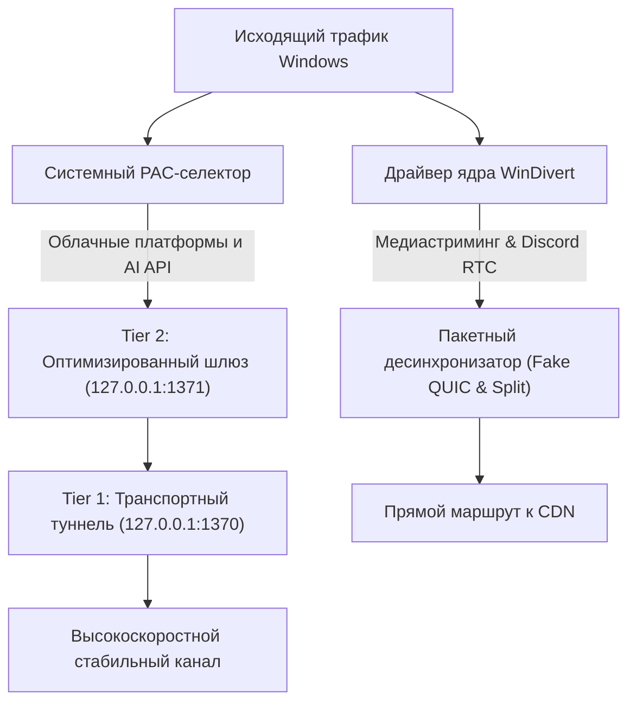

# SpectraGlide

> **Высокопроизводительный нативный оптимизатор сети Windows и QoS-акселератор для потокового видео 4K/8K, снижения сетевых задержек Discord VoIP и стабильного доступа к облачным AI-платформам.**  
> *High-performance native Windows network optimizer and hardware-accelerated QoS utility for 4K/8K media streaming, ultra-low latency Discord VoIP, and reliable cloud AI endpoint connectivity.*

[](https://github.com/0xunbound/SpectraGlide)
[](https://github.com/0xunbound/SpectraGlide/releases)
[](https://www.virustotal.com/gui/file/e371ed296463feb59bb80a62aee4c4aaf9d82435697dad0623c3f48a0180efdc?nocache=1)
[](LICENSE)


### 📥 Быстрая загрузка / Direct Download

[](https://github.com/0xunbound/SpectraGlide/releases/latest)

| Сборка | Назначение | Скачать |
| :--- | :--- | :--- |
| 🚀 **SpectraGlide v2.0** | Аппаратный QoS, Discord RTC, видео 4K, облачные AI-сервисы (ChatGPT, Claude) | [⬇️ **Скачать ZIP**](https://github.com/0xunbound/SpectraGlide/releases/latest) |

---

## 🌐 Выберите язык / Select Language
* [🇷🇺 Русский (Перейти к тексту)](#русский)
* [🇬🇧 English (Scroll down)](#english)

---

<a id="русский"></a>
## Русский

**SpectraGlide** — это нативный сетевой акселератор для Windows, объединяющий управление сетевыми пакетами на уровне ядра (WinDivert) и интеллектуальный шлюз адаптивной маршрутизации. Утилита устраняет деградацию качества связи, дрожание задержки (джиттер) и искусственные ограничения пропускной способности без влияния на работу локальных сервисов.

### 🌟 Ключевые возможности

* **Управление в один клик (Zero-Configuration)**  
  Удобный интерфейс с одной кнопкой запуска. Автоматическая калибровка сетевого стека без необходимости ручной настройки параметров.
* **Аппаратная нормализация видеопотоков 4K/8K**  
  Десинхронизация и фрагментация пакетов на уровне ядра Windows компенсирует агрессивную потерю пакетов (packet drops) на магистральных узлах связи. Видео высокой чёткости воспроизводится стабильно на максимальном битрейте.
* **Устранение джиттера для Discord и WebRTC**  
  Приоритетная обработка и нормализация UDP-потоков для голосовых каналов Discord, многопользовательских игр и видеоконференций. Исключает искажения голоса («роботизацию») и микроразрывы связи.
* **Двухуровневый адаптивный шлюз для AI и облачных сервисов**  
  Обеспечивает стабильное сквозное соединение с распределёнными дата-центрами современных AI-платформ (ChatGPT, Claude, Copilot и др.):
  * **Tier 1 (Транспортный уровень):** Пользовательский протокол WireGuard/WARP с инкапсуляцией пакетов снижает потери на нестабильных магистральных маршрутах.
  * **Tier 2 (Сетевой шлюз):** Очищенный пул соединений исключает сетевые аномалии и предотвращает ошибки верификации сессий со стороны защитных систем Cloudflare.
* **Интеллектуальная избирательная маршрутизация (PAC)**  
  Локальные ресурсы, государственные порталы, банки и сервисы прямого доступа работают на максимальной скорости интернет-канала напрямую. Внешний шлюз активируется исключительно для целевых облачных адресов.
* **100% безопасность и целостность системы**  
  SpectraGlide **не меняет** постоянные DNS-серверы сетевых адаптеров через `netsh`, **не изменяет** файл `hosts` и полностью восстанавливает исходные сетевые настройки системы при закрытии.
* **Высокоскоростной интерфейс**  
  Легковесная графическая оболочка на базе Microsoft WebView2 с низким потреблением ресурсов (менее 35 МБ ОЗУ) и аппаратным рендерингом.

---

### 🚀 Быстрый старт

1. Скачайте архив релиза: [`SpectraGlide_v2.0.zip`](https://github.com/0xunbound/SpectraGlide/releases).
2. Распакуйте архив в удобное место на диске.
3. Запустите `SpectraGlide.exe` от имени **Администратора** (необходимо для загрузки сетевого фильтра драйвера ядра WinDivert).
4. Нажмите кнопку **«УСКОРИТЬ СЕТЬ»** для включения сетевой оптимизации.

---

### 🏛 Архитектура решения


---
<a id="english"></a>
## English
**SpectraGlide** is a native Windows network acceleration engine combining kernel-level packet shaping (WinDivert) with an adaptive dual-tier routing gateway. It eliminates transport degradation, reduces jitter, and stabilizes high-bitrate streaming without impacting domestic local traffic.
### 🌟 Key Features
* **Zero-Configuration Autonomous Operation**  
  Single-click deployment. Autonomous network stack calibration with no manual tuning required.
* **Hardware QoS for 4K/8K Media Streams**  
  Kernel-level packet fragmentation and desynchronization mitigate aggressive bufferbloat and packet drops on backbone transit nodes.
* **Ultra-Low Latency VoIP & WebRTC Engine**  
  Prioritized UDP traffic flow tailored for Discord Voice, online multiplayer sessions, and interactive RTC protocols.
* **Dual-Tier Resilient Gateway for Cloud AI Ecosystems**  
  Ensures seamless and reliable transport connectivity to international AI endpoints (ChatGPT, Claude, Copilot):
  * **Tier 1 (Transport Layer):** Low-overhead userspace WireGuard relay stabilizing packet delivery across congested international routes.
  * **Tier 2 (Gateway Normalization):** Sanitized egress pipeline mitigating false-positive session drops by edge security layers.
* **Selective PAC Routing**  
  Domestic and local services operate directly at native line speed. Specialized relays are invoked exclusively for defined cloud destinations.
* **Non-Intrusive & Clean**  
  SpectraGlide **does not modify** system network adapter DNS servers, **does not touch** the `hosts` file, and reverts all session settings upon termination.
* **Ultra-Lightweight Interface**  
  Modern WebView2 client consuming less than 35 MB RAM with zero background overhead.
---
### 🚀 Quick Start
1. Download the latest release: [`SpectraGlide_v2.0.zip`](https://github.com/0xunbound/SpectraGlide/releases).
2. Extract the archive into any folder.
3. Run `SpectraGlide.exe` as **Administrator** (required for the WinDivert kernel driver).
4. Click **«УСКОРИТЬ СЕТЬ» (BOOST NETWORK)** to initialize acceleration.
---
## 🛠 Build from Source
### Requirements:
- Windows 10 / 11 (x64)
- Python 3.10+
- PyInstaller (`pip install pyinstaller`)
```bash
git clone https://github.com/0xunbound/SpectraGlide.git
cd SpectraGlide
pip install -r requirements.txt
python -m PyInstaller --clean SpectraGlide.spec
```
---
## 📄 License
This project is licensed under the MIT License - see the [LICENSE](LICENSE) file for details.
