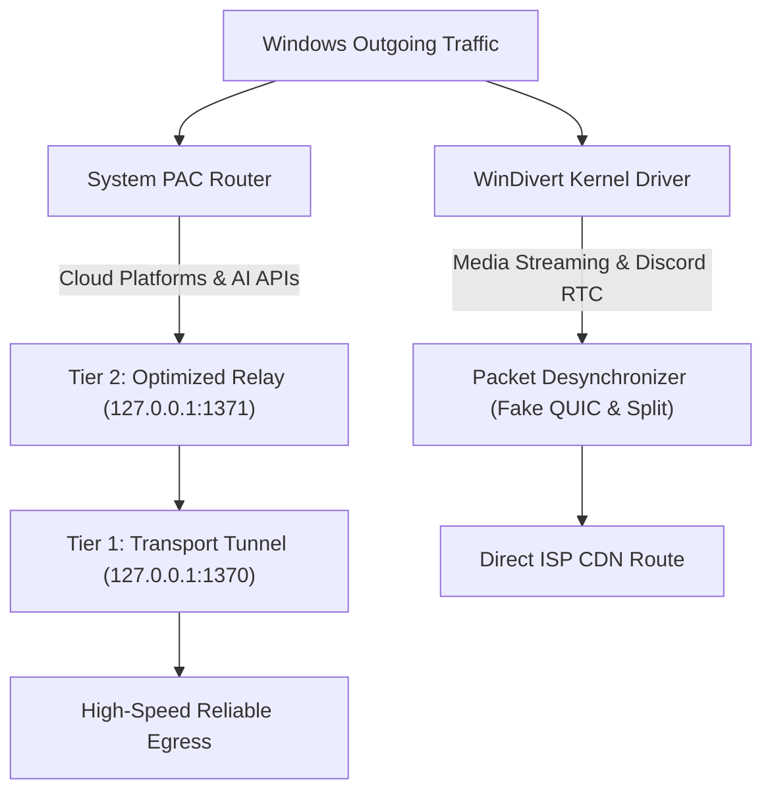

# SpectraGlide

> **High-performance native Windows network optimizer and hardware-accelerated QoS utility for 4K/8K media streaming, ultra-low latency Discord VoIP, and reliable cloud AI endpoint connectivity.**

[](https://github.com/0xunbound/SpectraGlide)
[](https://github.com/0xunbound/SpectraGlide/releases)
[](LICENSE)

### 📥 Direct Download / Быстрая загрузка

[](https://github.com/0xunbound/SpectraGlide/releases/latest)

| Build | Purpose | Download |
| :--- | :--- | :--- |
| 🚀 **SpectraGlide v2.0** | Hardware QoS, Discord RTC, 4K streaming, Cloud AI (ChatGPT, Claude) | [⬇️ **Download ZIP**](https://github.com/0xunbound/SpectraGlide/releases/latest) |
| 🧠 **SpectraGlide-Gemini** | Extended edition with dedicated routing gateway for Google services | [⬇️ **Download ZIP**](https://github.com/0xunbound/SpectraGlide/releases/latest) |

---

## 🌐 Select Language / Выберите язык
* [🇬🇧 English](README_EN.md)
* [🇷🇺 Русский (Russian)](README.md)

---

**SpectraGlide** is a native Windows network acceleration engine combining kernel-level packet shaping (WinDivert) with an adaptive dual-tier routing gateway. It eliminates transport degradation, reduces jitter, and stabilizes high-bitrate streaming without impacting domestic local traffic.

### 🌟 Key Features

* **Zero-Configuration Autonomous Operation**  
  Single-click deployment. Autonomous network stack calibration with no manual tuning required.
* **Hardware QoS for 4K/8K Media Streams**  
  Kernel-level packet fragmentation and desynchronization mitigate aggressive bufferbloat and packet drops on backbone transit nodes.
* **Ultra-Low Latency VoIP & WebRTC Engine**  
  Prioritized UDP traffic flow tailored for Discord Voice, online multiplayer sessions, and interactive RTC protocols.
* **Dual-Tier Resilient Gateway for Cloud AI Ecosystems**  
  Ensures seamless and reliable transport connectivity to international AI endpoints (ChatGPT, Claude, Copilot):
  * **Tier 1 (Transport Layer):** Low-overhead userspace WireGuard relay stabilizing packet delivery across congested international routes.
  * **Tier 2 (Gateway Normalization):** Sanitized egress pipeline mitigating false-positive session drops by edge security layers.
* **Selective PAC Routing**  
  Domestic and local services operate directly at native line speed. Specialized relays are invoked exclusively for defined cloud destinations.
* **Non-Intrusive & Clean**  
  SpectraGlide **does not modify** system network adapter DNS servers, **does not touch** the `hosts` file, and reverts all session settings upon termination.
* **Ultra-Lightweight Interface**  
  Modern WebView2 client consuming less than 35 MB RAM with zero background overhead.

---

### 🚀 Quick Start

1. Download the latest release: [`SpectraGlide_v2.0.zip`](https://github.com/0xunbound/SpectraGlide/releases).
2. Extract the archive into any folder.
3. Run `SpectraGlide.exe` as **Administrator** (required for the WinDivert kernel driver).
4. Click **«УСКОРИТЬ СЕТЬ» (BOOST NETWORK)** to initialize acceleration.

---

### 🏛 Architecture Overview



---

## 🛠 Build from Source

### Requirements:
- Windows 10 / 11 (x64)
- Python 3.10+
- PyInstaller (`pip install pyinstaller`)

```bash
git clone https://github.com/0xunbound/SpectraGlide.git
cd SpectraGlide
pip install -r requirements.txt
python -m PyInstaller --clean SpectraGlide.spec
```

---

## 📄 License

This project is licensed under the MIT License - see the [LICENSE](LICENSE) file for details.
